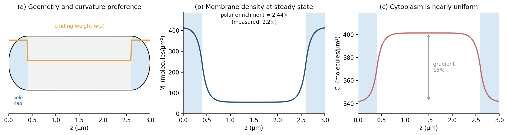
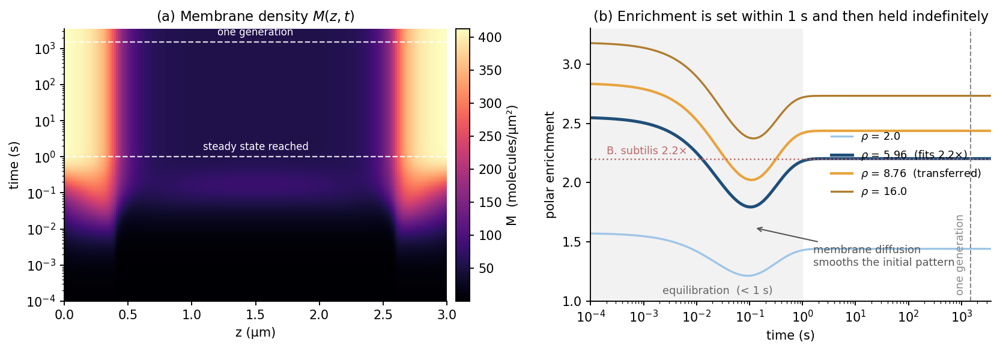
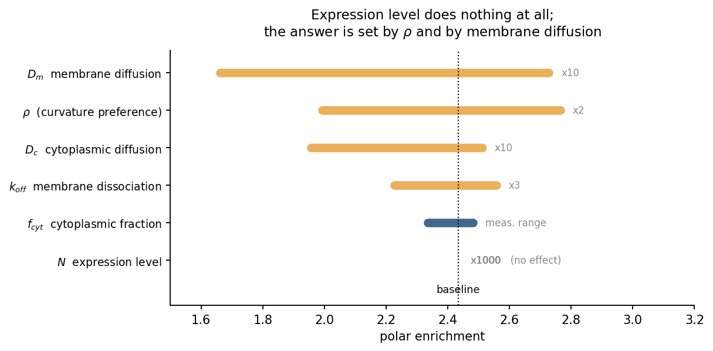
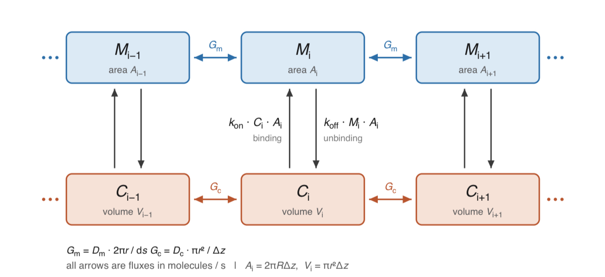

# モデル 2：DivIVA 二極局在の破壊戦略の事前評価

## 目次

- [目的](#目的)
- [サイクルの一覧](#サイクルの一覧)
- [cycle 1：簡単な DivIVA モデル](#cycle-1簡単な-diviva-モデル)
- [cycle 2：クラスター場の導入](#cycle-2クラスター場の導入)
- [cycle 3：実験データによる改善（skip）](#cycle-3実験データによる改善skip)
- [cycle 4：PopZ の導入と手法の比較](#cycle-4popz-の導入と手法の比較)
- [参考文献](#参考文献)

---

## 目的

DivIVA の二極局在を能動的に破る方法として、先に発現させた PopZ による次の 2 つの機構が考えられている。

1. **空間占有**：PopZ が極を先に占めて DivIVA を締め出す
2. **局所分解**：極で DivIVA を分解する

どちらの戦略でも、PopZ 濃度・DivIVA 濃度・誘導タイミング・切断速度など変数が多く、すべてを Wet で振るのは時間的に不可能である。

- このモデルの役割は、**有効な戦略と濃度域を事前に絞り込み、Wet が試す条件を限定すること**にある。
- 今後、応用に応じて誘導タイミングや濃度の制約が増えた場合も、各手法がどの条件で安定かを比較できる。

## サイクルの一覧

| cycle | 内容 | 状態 | 主な結論 |
| --- | --- | --- | --- |
| 1 | DivIVA 単体の結合・拡散モデル（C ↔ M） | 完了 | 極濃縮は再現できるが、単量体 1 個に要求する曲率エネルギーが非現実的。FRAP も 1000 倍以上速い |
| 2 | 自己集合クラスター場 N を追加（C ↔ M ↔ N） | 完了 | 結合強度比と FRAP の問題をともに解決。局在の立ち上がりはほぼ一世代かかる |
| 3 | 実験データによる値の照合 | skip | Wet へのフィードバック方針だけ記録 |
| 4 | PopZ の導入、空間占有と分解の比較 | 未着手 | — |

---

## cycle 1：簡単な DivIVA モデル

### 目的

- DivIVA 単体のモデルを構築する。
- できるだけシンプルに、DivIVA の性質である**曲率認識**（膜曲率によって結合強度が変わる）のパラメータだけで、文献の極／非極の濃縮率を再現できるかを確かめる。

### 手法

- DivIVA 単体の単純な結合・拡散モデル。
  - 大腸菌のジオメトリは文献から取得して定義した（図 1）。
  - 拡散速度や結合定数などは *Bacillus subtilis* の DivIVA の文献値を用いた。
    - 細胞質拡散 $D_c$ だけは大腸菌の値（Elowitz 1999）。
  - 未知のパラメータは、曲率認識にかかわる**結合強度比 ρ**（極／側壁）のみ。

細胞質（cytosol）の濃度 $C$：

$$
\frac{\partial C}{\partial t} = D_c \nabla^2 C - \frac{A}{V}\left(k_{on}(z)\,C - k_{off}M\right)
$$

膜（membrane）の濃度 $M$：

$$
\frac{\partial M}{\partial t} = D_m \nabla^2 M + \left(k_{on}(z)\,C - k_{off}M\right)
$$

### 結果

1. **極は均一分布から約 1 秒で形成され、その後ずっと維持される。**
   - 局在は、発現・成長・PopZ 誘導に対して準静的に扱ってよい。
2. **要求される結合強度比が、膜曲率の差に対して大きすぎる。**
   - スキャンの結果、文献の極／非極比を出すには **ρ = 6.0** が必要。しかし極と非極の膜曲率は 2 倍しか違わない。
   - DivIVA 単量体（長さ約 30 nm）が半径 400 nm の曲面に沿うときのたわみはわずか 0.28 nm（水分子より小さい）で、worm-like chain モデルで見積もったエネルギー差は **0.0094 k_BT** にすぎない。→ **極と側壁の曲率差を熱ゆらぎの中から拾えない。**
3. **交換が速すぎる。**
   - 交換速度は文献の FRAP より 1000 倍以上速い。
4. **DivIVA の発現量は局在に影響しない**（図 3）。
   - PopZ 導入後の分解能などに応じて、発現量は自由に変えてよい可能性がある。

### 次に変えたこと

結合強度比が大きすぎる問題と、交換が速すぎる問題を解決するため、cycle 2 で DivIVA の自己集合（クラスター）を導入する。

### 図

| 図 | 内容 |
| --- | --- |
|  | **図 1**　大腸菌ジオメトリの定義と定常状態 |
|  | **図 2**　単純モデルの時間発展 |
|  | **図 3**　パラメータスキャン：どのパラメータが局在に効くか |
|  | **図 4**　現在の場 |

---

## cycle 2：クラスター場の導入

### 目的

cycle 1 の 2 つの問題（結合強度比が大きすぎる、FRAP が速すぎる）を、DivIVA の性質である**自己集合によるクラスター場**を導入して解決する。

### 手法

- 場を C ↔ M から **C ↔ M ↔ N**（N：クラスター）に拡張した。
- 曲率認識の項を、単量体ではなく**クラスター**に移した。
  - 単量体の結合は**一様**（曲率に無関心）にした。
  - クラスターは実測上ほとんど動かない（拡散係数の上限 2×10⁻⁵ µm²/s は単量体の 0.1 µm²/s より 4 桁小さい）ので、クラスター場には拡散項を置かない。
  - cycle 1 では膜拡散がパターンをならすため、極濃縮に 1/a = 3.75 という天井があった。動かないクラスターにはこの天井がない。

細胞質 $C$：

$$
\frac{\partial C}{\partial t} = D_c \nabla^2 C + \left[-\left(k_{on}(z)\,C - k_{off}M\right) + (1-f_{nm})\,k_{off,n}(z)\,N\right]\frac{A}{V}
$$

膜上の単量体 $M$：

$$
\frac{\partial M}{\partial t} = D_m \nabla^2 M + \left(k_{on}(z)\,C - k_{off}M\right) - G + f_{nm}\,k_{off,n}(z)\,N
$$

クラスター $N$：

$$
\frac{\partial N}{\partial t} = G - k_{off,n}(z)\,N
$$

クラスター成長項 $G$（クラスター量 $N$ に応じて指数 $p$ で成長が速くなる）：

$$
G = \left(k_{nuc} + k_{grow}\,N^{\,p}\right) M
$$

クラスターの解離速度に重み $w_n$ を入れ、極ではクラスターの寿命が $\rho_n$ 倍になるようにした：

$$
k_{off,n}(z) = \frac{k^{0}_{off,n}}{w_n(z)},\qquad
w_n(z) = \begin{cases} \rho_n & (\text{pole}) \\ 1 & (\text{sidewall}) \end{cases}
$$

#### パラメータ

未知のパラメータは 2 つ。

- **ρ_n**（極／側壁のクラスター寿命比）：求める量。文献の「クラスター分子の 66% が極・隔壁にある」から校正する。
- **p**（成長の次数）：実測の裏付けがない。既定値 0.5 は「2 次元のパッチは縁でしか成長できず、Q 分子のパッチの周長は √Q に比例する」という幾何的な議論だけに基づく。

$k_{on}$ と $k_{grow}$ は独立なパラメータではなく、積分量が実測で固定される（cycle 1 の $k_{on}$ と同じ）。

校正に使った実測値（いずれも *B. subtilis*）：

| 実測値 | 手法 | 決まるもの |
| --- | --- | --- |
| 3 相分配 29.6 / 50.7 / 19.8%（細胞質／膜上単量体／クラスター） | 一分子追跡 | $k_{on}$, $k_{grow}$ |
| クラスター分子の 66% が極・隔壁にある | PALM | **ρ_n = 2.37** |
| クラスターの T₁ᐟ₂ = 128 秒 | FRAP | $k^0_{off,n}$ |

#### 検証

結果を出す前に 13 項目の検証を通した。

- **クラスターを消すと cycle 1 の答えに有効数字 10 桁で戻る**（相対差 1.5×10⁻¹¹）。したがって両サイクルの違いは「クラスターの有無だけ」に帰せる。
- 質量保存の誤差 6.1×10⁻¹³、クラスター収支の誤差 1.2×10⁻¹⁰。

### 結果

1. **結合強度比の問題は解決した。**
   - cycle 1 は ρ = 6.0、つまり ln ρ = 1.79 k_BT を**単量体 1 個**に要求していた。単量体が曲率差から得られるエネルギーは 0.0094 k_BT なので、単量体 190 個分を 1 個に出させることになり、正当化できなかった。
   - cycle 2 が要求するのは ln ρ_n = 0.863 k_BT = **92 分子分**。実測のクラスターは**平均 47 分子・最大 1198 分子**なので、観測されている分布の中に収まる。
   - ★ 解決の中身は「必要なエネルギーが小さくなった」ことではない（190 → 92 で 2 倍しか減っていない）。**同じエネルギーを 1 個ではなく多数の分子で分担できるようになった**ことである。
2. **FRAP の問題も 3 桁改善した。**
   - モデルは回復が**二相**になると予測する：**速相 88 ミリ秒（振幅 53%、単量体）** と **遅相 425 秒（振幅 47%、クラスター）**。
   - 実測（単一指数フィット）は 51〜129 秒。遅相とのずれは 3.3〜8.3 倍で、cycle 1 の 515〜1301 倍から 3 桁縮み、向きも逆転した（速すぎる → やや遅い）。
   - 残るずれは、実測側が二相の回復を単一指数でフィットしている（速相に引かれて見かけが短くなる）ことで説明できる可能性がある。原著の回復曲線で二相性の痕跡を探してみるとよい。
3. **極濃縮には 2 種類あり、数字が違う。**
   - **クラスターだけ = 2.50 倍**、**膜全体（蛍光で見える量）= 1.42 倍**。
   - 膜上の DivIVA の 3 分の 2 は単量体で、単量体は曲率に無関心なので平坦に分布する。クラスターの面密度は極 112 分子/µm²・側壁 20 分子/µm² で 5.6 倍の段差があるが、その上に平坦な単量体が重なる。
   - ⚠️ **実験と比べるときは、PALM でクラスターを分離して数えているなら 2.50、蛍光強度の比なら 1.42 と比べる。** 混同すると 1.8 倍ずれる。
4. **局在が立ち上がるのに、ほぼ一世代かかるようになった。**
   - 定常の 99% に達するのに **1399 秒**（世代時間 1500 秒の 0.93 倍）。cycle 1 では 0.014 秒だった。
   - ★ **cycle 1 の「局在は準静的に扱ってよい」という結論は、cycle 2 では成り立たない。** PopZ を先に発現させるのに必要な先行時間は、分オーダーではなく**十数分〜一世代**である。
5. **効くパラメータは ρ_n と p の 2 つだけ。**
   - 実測で決まっている量（$k_{off,n}$、クラスター割合、$D_m$）はクラスター濃縮にほとんど効かない。$D_m$ が効かなくなったのは cycle 1 との違いで、パターンを作るのが拡散しないクラスターになったため。
   - DivIVA の発現量は、$k_{grow}$ をクラスター割合に校正し続ける限り**厳密に効かない**（スケーリング対称性）。cycle 1 と同じ構造。
   - ⚠️ ただしこれは**クラスター濃縮**についての話。**蛍光で見える膜全体の濃縮には、クラスター割合が大きく効く**（考察を参照）。

### 考察

- **モデルを本当に支持するのは、校正に使っていない測定が合ったときだけ。** 3 相分配・66%・T₁ᐟ₂ の 3 つは校正に使ったので、合うのは当然である。
- **最も強い証拠**：PALM で測った最大クラスターサイズ 1198 分子に、結晶構造から読んだ四量体の footprint 30×4 nm を掛けると、円板としての半径は **107 nm**。これが一分子追跡で測った**拘束半径 97 nm** と一致する。三つの論文・三つの異なる手法で、どれも局在の校正には使っていない。「クラスターが物理的な閉じ込めの正体である」という描像を支持する。
- **再フィットなしの種間予測**：ρ_n も形も固定したまま、一分子追跡のクラスター画分だけを *C. glutamicum* の値（76.1%）に差し替えると、膜全体の極濃縮が 1.42 → **2.25**、極にいる分子の割合が 26.7% → **54.8%** になり、*C. glutamicum* の足場が格段に鋭いことを再現する。**クラスターの濃縮は 2.50 のまま変わらない**点が重要で、モデルの主張は「足場の鋭さ自体は種によらず、違うのはクラスターに入っている割合だけ」という反証可能な形になる。
- **決められない量は効かない**：クラスターが壊れたとき膜に戻るか細胞質に戻るかの分岐比 $f_{nm}$ は、FRAP が総脱出速度しか測らないため原理的に決められない。しかし 0 と 1 の両端で答えは 10⁻⁴ しか動かない。

#### 限界

- クラスターの**サイズ分布を持たない**。「クラスターに属する分子の量」だけを追っているので、47 分子のクラスターと 1198 分子のクラスターを区別できない。「92 分子必要」は代表値の話である。
- **隔壁（分裂面）を持たない**。校正に使った 66% は「極**および隔壁**」の割合なので、その分だけ極の効果を過大評価している。
- **希釈と合成を入れていない**。局在の立ち上がりが世代時間と同程度だと分かった以上、この近似の根拠は弱い。
- 速度定数はすべて *B. subtilis* 由来。**大腸菌に DivIVA は存在しない**ので置き換える先がなく、移植可能性そのものが仮定である。
- 曲率エネルギーに使った持続長 100 nm は DivIVA の実測値ではない。**1 桁の不確かさで必要クラスターサイズが 34 倍動く**（9〜307 分子）。3 倍小さいだけで 307 分子となり、実測の平均 47 分子を大きく超える。
- クラスター画分が、同じ研究グループの 2 つの測定（PALM 52%、一分子追跡 20%）で 2.6 倍食い違っている。しかも一分子追跡の値は撮影速度によって 19.8% と 55.0% の間を動く。クラスター濃縮にはほぼ効かないが、**蛍光で見える膜全体の濃縮には 1.42 対 1.98 と大きく効く**ので、実験値と比べるときは撮影条件まで揃える必要がある。

★ **結論の不確かさは、事実上すべて p に集中している。** ρ_n は校正で決まり、ほかのパラメータは効かないため。

### 次のサイクル

- PopZ 項の導入と、有効な手法の検討。

---

## cycle 3：実験データによる改善（skip）

### 目的

- 実際のデータの整理
- 値の照合と修正
- Wet へのフィードバック。現状の設計方針：
  - **PopZ 濃度**は、両極に行かない範囲での最大くらいがよい。
  - **DivIVA**は局在が見える最低ラインがよい。ただし分解案と占有案で総量が変わるので、Dry で検証する余地がある。

### 次のステップ

- PopZ の定義と、手法の比較。

---

## cycle 4：PopZ の導入と手法の比較

（未着手）

### 次のサイクル

- 実際のデータを用いた補正
- 妥当性の検証

### メモ：本田さんへの質問

- 距離・方向の制御は、共培養と比べてどれくらい有利か。

---

## 参考文献

- Giacomelli G, Feddersen H, Peng F, et al. Subcellular Dynamics of a Conserved Bacterial Polar Scaffold Protein. *Genes* 2022;13(2):278. doi:10.3390/genes13020278
- Feddersen H, Würthner L, Frey E, Bramkamp M. Dynamics of the *Bacillus subtilis* Min System. *mBio* 2021;12(2):e00296-21. doi:10.1128/mBio.00296-21
- Lenarcic R, Halbedel S, Visser L, et al. Localisation of DivIVA by targeting to negatively curved membranes. *EMBO J* 2009;28:2272–2282
- Ramamurthi KS, Losick R. Negative membrane curvature as a cue for subcellular localization of a bacterial protein. *PNAS* 2009;106:13541–13545
- Oliva MA, Halbedel S, Freund SM, et al. Features critical for membrane binding revealed by DivIVA crystal structure. *EMBO J* 2010;29:1988–2001
- Elowitz MB, Surette MG, Wolf PE, Stock JB, Leibler S. Protein mobility in the cytoplasm of *Escherichia coli*. *J Bacteriol* 1999;181:197–203

## 用いたプログラム

[`code/`](code/) を参照。
